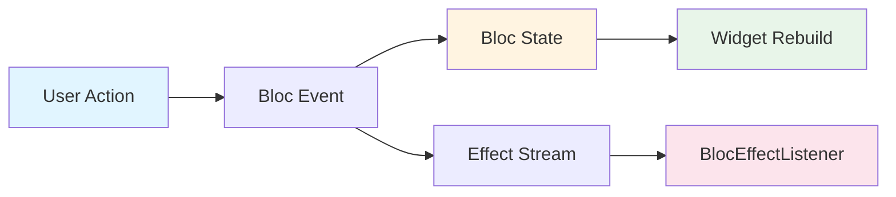
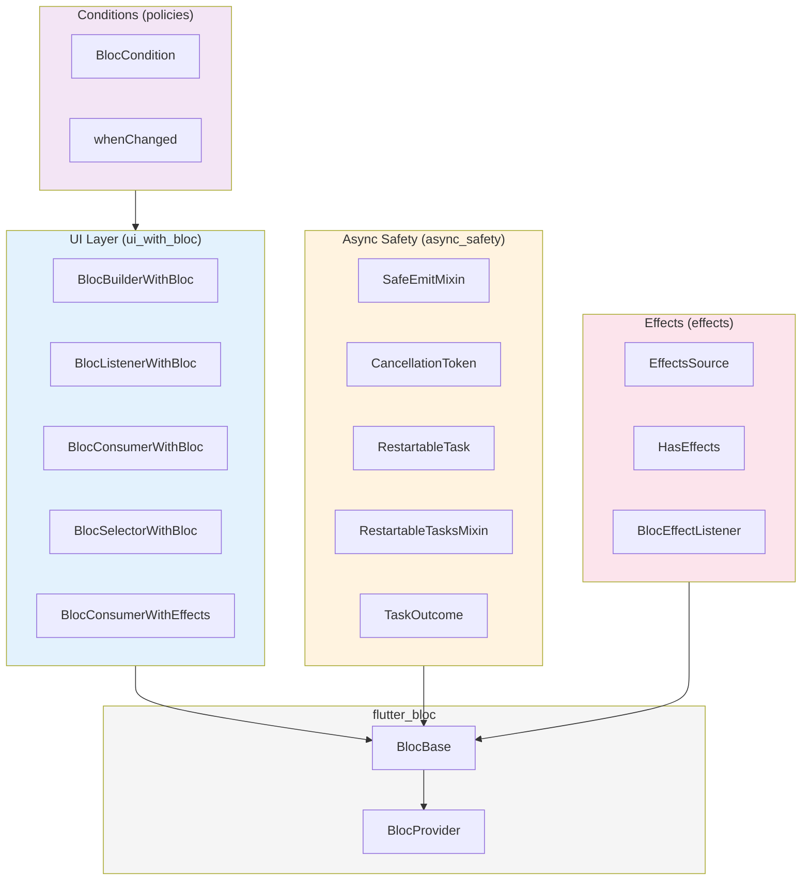
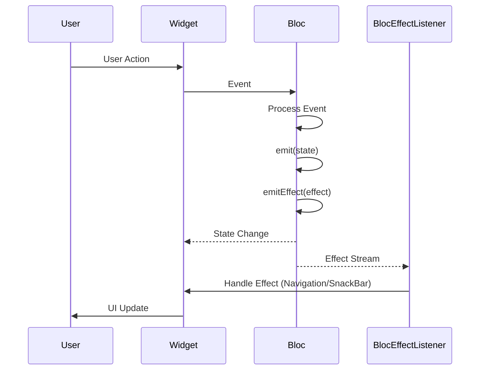

# Product Requirements Document

Product name: `bloc_plus`

------------------------------------------------------------------------

## 1. Overview

### 1.1 Purpose

`bloc_plus` is a Flutter package extending `flutter_bloc` with:

- UI widgets that expose the underlying Bloc/Cubit instance directly
    in callbacks
- Async safety utilities to prevent common lifecycle-related crashes
- Effect handling primitives for one-shot UI events
- Optional rebuild/listen conditions to reduce boilerplate and increase
    correctness

This document describes the API at version 0.4.0. When it and the code
disagree, `lib/` and `CHANGELOG.md` win; fix this document.

The package must be:

- Fully compatible with `flutter_bloc` and can be used alongside it
- Zero magic, minimal abstraction overhead
- Fully type-safe
- Production-grade
- Lightweight (no heavy dependencies)

------------------------------------------------------------------------

## 2. Problem Statement

In real-world Flutter BLoC projects:

1. `BlocBuilder`/`BlocListener` do not expose the bloc instance in
    callbacks.
2. Async operations often cause post-close emit crashes.
3. One-shot effects (navigation/snackbars) pollute state models.
4. Rebuild/listen logic is repeatedly implemented via lambdas.

------------------------------------------------------------------------

## 3. Goals

### 3.1 Primary Goals

- Improve UI ergonomics
- Improve async correctness
- Provide clean effect architecture
- Maintain full compatibility with flutter_bloc

### 3.2 Non-Goals

- Not replacing flutter_bloc
- Not creating a new state management framework
- Not enforcing architecture patterns

### 3.3 Delivered Expansion Goals

> Historical: these goals were delivered in 0.2.0. In 0.3.0 `RebuildPolicy`,
> `ListenPolicy` and their 12 factories (with `and` / `or` / `not`),
> `EffectListener`, `MultiEffectListener` and `SingleChildEffectListener`
> were deprecated, to be removed in 1.0. Their replacements are plain
> conditions (`whenChanged`) and `BlocEffectListener` inside
> `MultiBlocListener`. `effectWhen` lived on in `BlocEffectListener` until
> 0.4.0 deprecated it too, for an `if` at the top of `onEffect`. Current
> status: `CHANGELOG.md`.

After the initial `v0.x` baseline, the package adds targeted ergonomic
improvements that preserve the lightweight design:

- Compose rebuild/listen policies instead of relying on ad-hoc predicates
- Support custom equality for selector-based policy decisions
- Improve effect handling ergonomics with filtering and flatter listener
    composition
- Add higher-level async helpers for common restartable workflows
- Evaluate a combined state-and-effect consumer only if it remains explicit
    and low-magic

------------------------------------------------------------------------

## 4. Technical Requirements

### 4.1 Environment Requirements

- **Flutter**: >=3.10.0
- **Dart**: >=3.0.0 <4.0.0
- **Null Safety**: Required (sound null safety)

### 4.2 Dependencies

- **flutter_bloc**: >=9.0.0, <10.0.0
- **bloc**: >=9.2.1, <10.0.0 (raised in 0.2.2: from 9.2.1 the `isClosed` of
    a `Bloc` is `true` from the call of `close()`, which the migration of a
    `Bloc` away from `SafeEmitMixin` in 0.4.0 relies on)
- **provider**: >=6.0.0, <7.0.0 (direct since 0.3.0; the range
    `flutter_bloc` already requires)
- No additional heavy dependencies

### 4.3 Platform Support

- **iOS**: Supported (iOS 11+)
- **Android**: Supported (API level 21+)
- **Web**: Supported
- **Windows**: Supported
- **macOS**: Supported
- **Linux**: Supported

### 4.4 Compatibility

- Compatible with public `flutter_bloc` APIs in supported versions
- Can be used alongside existing `flutter_bloc` widgets
- Does not modify or monkey-patch `flutter_bloc` runtime behavior
- Backward compatible with existing BLoC patterns

### 4.5 Package Bootstrap (Required)

> Historical: the scaffold exists since 0.1.0. Do not re-run
> `flutter create` in this repository; `AGENTS.md` section 3 governs it.

Before implementing any module, the agent MUST ensure the repository is a valid Flutter package scaffold.

- If package scaffold is missing, create it with:
  - `flutter create --template=package bloc_plus` (when running from parent directory)
  - `flutter create --template=package .` (when already in package root)
- For this repository layout, prefer `flutter create --template=package .` to avoid nested `bloc_plus/bloc_plus`.
- Do not start module implementation before scaffold exists.
- Required baseline artifacts after bootstrap:
  - `pubspec.yaml`
  - `lib/bloc_plus.dart`
  - `test/`
  - `example/`
- Immediately after scaffold creation:
  - Add `flutter_bloc` and `bloc` constraints from section 4.2
  - Run `flutter pub get`
  - Run `flutter analyze` once to validate clean baseline

### 4.6 Package Metadata & Publish Readiness

The agent should treat these as required package deliverables:

- `pubspec.yaml` includes:
  - `name: bloc_plus`
  - SDK constraints aligned with section 4.1
  - `flutter_bloc` and `bloc` dependency constraints from section 4.2
  - package metadata (`description` and `repository`; pub.dev derives
        the issue tracker from it)
- Required top-level files:
  - `README.md`
  - `CHANGELOG.md`
  - `LICENSE`
  - `analysis_options.yaml`
- Public entrypoint:
  - `lib/bloc_plus.dart` exports only intended public APIs

------------------------------------------------------------------------

## 5. Architecture & Design Decisions

### 5.1 Design Philosophy

`bloc_plus` follows these principles:

1. **Zero Magic**: No hidden behavior, all operations are explicit
2. **Minimal Abstraction**: Thin wrappers around `flutter_bloc` widgets
3. **Type Safety**: Full compile-time type checking
4. **Composability**: All features can be used independently
5. **Performance**: Minimal overhead with benchmark-backed acceptance thresholds
    (historical: no benchmarks or thresholds were ever defined; see 10.4)

### 5.2 Module Independence

Each module (`ui_with_bloc`, `policies`, `context_extensions`, `async_safety`, `effects`) is independent and can be used separately:

- `ui_with_bloc` (UI widgets) can be used without other modules
- `policies` works with both standard and "WithBloc" widgets; since 0.3.0
    it means the conditions (`BlocCondition`, `whenChanged`), and the
    `RebuildPolicy` / `ListenPolicy` family is deprecated
- `context_extensions` is standalone utility
- `async_safety` is optional mixin/utilities set
- `effects` requires bloc implementation but is independent;
    `BlocConsumerWithEffects` lives with the widgets but needs `HasEffects`

### 5.3 Data Flow



### 5.4 Architecture Overview



### 5.5 Effect Flow



### 5.6 API Contract Before Code Generation

The coding agent MUST treat this section as binding over illustrative snippets in the document.

- Public API changes require PRD update first.
- All APIs in this document are declarative contracts, not implementation inheritance requirements.
- The implementation MUST use only public APIs from `flutter_bloc`/`bloc` in supported versions.
- Any API that depends on private/undocumented framework internals is out of scope.
- If a required behavior is impossible with public APIs, implementation must fail fast with a clear TODO in PR and a PRD amendment request.

#### API Freeze Table (v0.x scope)

| Symbol | Status | Contract Notes |
| --- | --- | --- |
| `BlocBuilderWithBloc` | stable | `B extends StateStreamable<S>`; `builder(context, bloc, state)`; composes `BlocBuilder` and follows the provided bloc after `bloc` becomes `null` (since 0.4.0) |
| `BlocListenerWithBloc` | stable | `B extends StateStreamable<S>`; `const`; `listener(context, bloc, state)`; composes `BlocListener` and follows the provided bloc after `bloc` becomes `null` (since 0.4.0) |
| `BlocConsumerWithBloc` | stable | Combines builder/listener with independent conditions; resolves the bloc once per build |
| `BlocSelectorWithBloc` | stable | Selects `T` and rebuilds on selected value inequality by default; parity with `BlocSelector`; `selectorShouldRebuild` is a `BlocCondition<T>` since 0.4.0 |
| `BlocSelectedCondition` | deprecated (0.4.0, removed in 1.0) | Replaced by `BlocCondition<T>`, the same function type |
| `BlocCondition` + `whenChanged` | stable (0.3.0) | Plain `bool Function(S previous, S current)`, passed directly as `buildWhen` / `listenWhen` / `selectorShouldRebuild` |
| `RebuildPolicy` | deprecated (0.3.0, removed in 1.0) | Replaced by `whenChanged` and plain predicates |
| `ListenPolicy` | deprecated (0.3.0, removed in 1.0) | Replaced by `whenChanged` and plain predicates |
| `BlocContextExtension` (`readOrNull`, `watchOrNull`, `selectOrNull`, `withBloc`) | deprecated (0.4.0, removed in 1.0) | Replaced by provider's nullable lookups `read<B?>()`, `watch<B?>()` and `select<B?, T?>()`, which return the same values with the same rebuilds; `package:flutter_bloc/flutter_bloc.dart` exports them, `bloc_plus` does not |
| `SafeEmitMixin` | stable | Silent no-op on closed bloc for `safeEmit` (`@protected`, `@visibleForTesting`); `guarded` takes a non-null `T` and is `@protected`, `@visibleForTesting` since 0.4.0; `on Cubit<S>` since 0.4.0 |
| `CancellationToken` | stable | Cooperative cancellation marker (does not force interrupt); `whenCancelled`; `final class` since 0.4.0; `run` takes a non-null `T` since 0.4.0 |
| `TaskOutcome` | stable (0.3.0) | Completed value or cancelled; tells a cancelled run apart from a `null` value |
| `RestartableTask` | stable | New run invalidates previous result and releases its caller at once; does not interrupt the underlying `Future`; `final class` since 0.4.0 |
| `RestartableTask.run` | deprecated (0.4.0, removed in 1.0) | Replaced by `runOutcome`: its `T` belongs to the class and cannot take the bound `T extends Object` |
| `RestartableTasksMixin` | stable | Keyed latest-result-wins helper for Cubits/Blocs with cooperative cancellation; `runLatest` takes a non-null `T` since 0.4.0; its members except `close` are `@protected`, `@visibleForTesting` since 0.4.0 |
| `EffectsSource` + `HasEffects` | stable | One-shot effect stream separated from state stream; `emitEffect` is `@protected`, `@visibleForTesting` |
| `debugPrintUnheardEffects` | stable (0.3.1) | Opt-in debug warning for an effect that nothing listens to; off by default; never prints in release builds |
| `BlocEffectListener` | stable (0.3.0) | `B extends EffectsSource<E>`; composes inside `MultiBlocListener` |
| `effectWhen`, `EffectCondition` | deprecated (0.4.0, removed in 1.0) | On `BlocEffectListener` and `BlocConsumerWithEffects`; replaced by an `if` or an if-case at the top of `onEffect`, which also promotes the effect type |
| `BlocEffectListener.withChild` | deprecated (0.4.0, removed in 1.0) | Serves only `MultiEffectListener`; replaced by `child:` or by `MultiBlocListener`, which supplies the child |
| `EffectListener` | deprecated (0.3.0, removed in 1.0) | Replaced by `BlocEffectListener` |
| `MultiEffectListener`, `SingleChildEffectListener` | deprecated (0.3.0, removed in 1.0) | Replaced by `MultiBlocListener` with `BlocEffectListener` |
| `BlocConsumerWithEffects` | stable | `B extends HasEffects<S, E>`; combines state builder/optional listener with effect handling; resolves the bloc once per build |
| `BlocEffectListenerWithBloc` | deprecated (0.4.0, removed in 1.0) | No replacement: nothing names it, and `onEffect` declares its function type inline |

### 5.7 Agent Execution Sequence (Required)

> Historical: this was the order for the first implementation; every step
> was done in 0.1.x. New work follows `AGENTS.md`.

The coding agent should execute work in this exact order:

1. Bootstrap package scaffold (section 4.5).
2. Apply dependency constraints (`flutter_bloc`, `bloc`) and run `flutter pub get`.
3. Implement `ui_with_bloc` and `context_extensions` (M1 scope).
4. Implement `policies`.
5. Implement `async_safety`.
6. Implement `effects`.
7. Run full validation: format, analyze, tests.
8. Update documentation and example app for implemented modules.

### 5.8 Implemented Expansion Track

> Historical: this table records 0.2.0. In 0.3.0 `RebuildPolicy`,
> `ListenPolicy` and their 12 factories (with `and` / `or` / `not`),
> `EffectListener`, `MultiEffectListener` and `SingleChildEffectListener`
> were deprecated, to be removed in 1.0. `effectWhen` lived on in
> `BlocEffectListener` until 0.4.0 deprecated it too. 0.3.0 added
> `BlocCondition` / `whenChanged`, `BlocEffectListener`, `TaskOutcome` with
> `runOutcome` / `runLatestOutcome`, and `CancellationToken.whenCancelled`;
> see the module sections below.

The items below were delivered as additive public APIs after the initial
baseline contract.

| Delivered addition | Motivation | Design guardrail |
| -------------------- | ------------ | ------------------ |
| Composable policies (`and`, `or`, `not`, `whenRebuild`, `whenListen`) | Reduce repeated inline `buildWhen` / `listenWhen` lambdas | Remain stateless and directly usable with `flutter_bloc` predicates |
| Selector policies with custom equality | Support lists, maps, DTOs, and derived values without relying only on `!=` | Equality stays explicit, with no hidden caching |
| Effect filtering via `effectWhen` | Keep `EffectListener` callbacks small and focused | Filtering remains transparent and type-safe |
| `MultiEffectListener` | Avoid deeply nested effect listeners | Follows established composition ergonomics |
| `RestartableTasksMixin` | Make `RestartableTask` easier to use in Cubits/Blocs | Keeps cooperative cancellation semantics explicit |
| `BlocConsumerWithEffects` | Simplify common screen wiring | Keeps state and effects semantically separate |

------------------------------------------------------------------------

## MODULE ui_with_bloc --- UI Layer Enhancements

### BlocBuilderWithBloc

Alternative widget to `BlocBuilder` that provides bloc instance directly in builder callback. Can be used alongside standard `flutter_bloc` widgets.

#### API Specification

```dart
typedef BlocWidgetBuilderWithBloc<B extends StateStreamable<S>, S> =
    Widget Function(BuildContext context, B bloc, S state);

class BlocBuilderWithBloc<B extends StateStreamable<S>, S>
    extends StatelessWidget {
  const BlocBuilderWithBloc({
    required this.builder,
    super.key,
    this.bloc,
    this.buildWhen,
  });

  final B? bloc;
  final BlocBuilderCondition<S>? buildWhen;
  final BlocWidgetBuilderWithBloc<B, S> builder;

  // Returns a BlocBuilder for bloc ?? context.select<B, B>((bloc) => bloc).
  @override
  Widget build(BuildContext context);
}
```

#### Parameters

- `bloc` (optional): The bloc instance to use. If not provided, the nearest provided bloc is used
- `buildWhen` (optional): Condition function to determine if rebuild is needed
- `builder`: Required builder function with signature `(context, bloc, state) -> Widget`

#### Behavior

- If `bloc` is null and not found in context, throws `ProviderNotFoundException`
- Builder receives both bloc instance and current state
- Rebuilds like `BlocBuilder`, which it returns: since 0.4.0 it composes
  `BlocBuilder` instead of extending `BlocBuilderBase`
- Full type safety maintained
- Accepts any `StateStreamable<S>`, like `BlocBuilder` (since 0.3.0)
- Since 0.4.0 it follows the provided bloc right after `bloc` changes from an
  instance to `null`, and when a different instance is provided; `buildWhen`
  then gets its previous state from the new bloc. A provided bloc that is
  created lazily is not created while `bloc` is set

#### Example Usage

```dart
BlocBuilderWithBloc<CounterBloc, CounterState>(
  builder: (context, bloc, state) {
    return Column(
      children: [
        Text('Count: ${state.count}'),
        ElevatedButton(
          onPressed: () => bloc.add(IncrementEvent()),
          child: Text('Increment'),
        ),
      ],
    );
  },
)
```

------------------------------------------------------------------------

### BlocListenerWithBloc

Alternative widget to `BlocListener` that provides bloc instance directly in listener callback. Can be used alongside standard `flutter_bloc` widgets.

#### API Specification

```dart
typedef BlocWidgetListenerWithBloc<B extends StateStreamable<S>, S> =
    void Function(BuildContext context, B bloc, S state);

class BlocListenerWithBloc<B extends StateStreamable<S>, S>
    extends SingleChildStatelessWidget {
  const BlocListenerWithBloc({
    required this.listener,
    super.key,
    this.bloc,
    this.listenWhen,
    this.child,
  }) : super(child: child);

  final B? bloc;
  final BlocListenerCondition<S>? listenWhen;
  final BlocWidgetListenerWithBloc<B, S> listener;
  final Widget? child;

  // Returns a BlocListener for bloc ?? context.select<B, B>((bloc) => bloc).
  @override
  Widget buildWithChild(BuildContext context, Widget? child);
}
```

#### Parameters

- `bloc` (optional): The bloc instance to use. If not provided, the nearest provided bloc is used
- `listenWhen` (optional): Condition function to determine if listener should be called
- `listener`: Required listener function with signature `(context, bloc, state) -> void`
- `child` (optional): Child widget to render; required unless a multi widget such as `MultiBlocListener` supplies it, and a missing child fails an assertion that names `BlocListenerWithBloc`

#### Behavior

- If `bloc` is null and not found in context, throws `ProviderNotFoundException`
- Listener receives both bloc instance and current state
- Listens like `BlocListener`, which it returns: since 0.4.0 it composes
  `BlocListener` instead of extending `BlocListenerBase`
- Listener is called once per state change when `listenWhen` returns true
- Accepts any `StateStreamable<S>`, like `BlocListener`, and has a `const`
    constructor (both since 0.3.0)
- Composes inside `MultiBlocListener`, like `BlocListener`
- Since 0.4.0 it follows the provided bloc right after `bloc` changes from an
  instance to `null`, and when a different instance is provided; `listenWhen`
  then gets its previous state from the new bloc. A provided bloc that is
  created lazily is not created while `bloc` is set

#### Example Usage

```dart
BlocListenerWithBloc<AuthBloc, AuthState>(
  listenWhen: whenChanged((state) => state.isAuthenticated),
  listener: (context, bloc, state) {
    if (state.isAuthenticated) {
      Navigator.pushReplacementNamed(context, '/home');
    } else {
      Navigator.pushReplacementNamed(context, '/login');
    }
  },
  child: MyWidget(),
)
```

------------------------------------------------------------------------

### BlocConsumerWithBloc

Combines `BlocBuilderWithBloc` and `BlocListenerWithBloc` functionality.

#### API Specification

```dart
class BlocConsumerWithBloc<B extends StateStreamable<S>, S>
    extends StatelessWidget {
  const BlocConsumerWithBloc({
    required this.listener,
    required this.builder,
    super.key,
    this.bloc,
    this.buildWhen,
    this.listenWhen,
  });

  final B? bloc;
  final BlocBuilderCondition<S>? buildWhen;
  final BlocListenerCondition<S>? listenWhen;
  final BlocWidgetListenerWithBloc<B, S> listener;
  final BlocWidgetBuilderWithBloc<B, S> builder;
}
```

#### Parameters

- `bloc` (optional): The bloc instance to use
- `buildWhen` (optional): Condition for rebuilds
- `listenWhen` (optional): Condition for listener calls
- `listener`: Required listener function
- `builder`: Required builder function

#### Behavior

- Combines listener and builder functionality
- Both callbacks receive bloc instance
- Independent conditions for listening and building
- If `bloc` is null and not found in context, throws `ProviderNotFoundException`
- Resolves the bloc once per build (since 0.3.0), so the callbacks always
    receive the bloc whose states they get, also right after `bloc` changes
    from an instance to `null`

#### Example Usage

```dart
BlocConsumerWithBloc<CounterBloc, CounterState>(
  listenWhen: (previous, current) => current.count == 10,
  listener: (context, bloc, state) {
    ScaffoldMessenger.of(context).showSnackBar(
      SnackBar(content: Text('Reached 10!')),
    );
  },
  builder: (context, bloc, state) {
    return Text('Count: ${state.count}');
  },
)
```

------------------------------------------------------------------------

### BlocSelectorWithBloc

Alternative widget to `BlocSelector` that provides bloc instance directly and avoids unnecessary rebuilds. Can be used alongside standard `flutter_bloc` widgets.

#### API Specification

```dart
typedef BlocSelectorBuilderWithBloc<B extends StateStreamable<S>, S, T> =
    Widget Function(BuildContext context, B bloc, T selected);

@Deprecated('...')
typedef BlocSelectedCondition<T> = bool Function(T previous, T current);

class BlocSelectorWithBloc<B extends StateStreamable<S>, S, T>
    extends StatefulWidget {
  const BlocSelectorWithBloc({
    required this.selector,
    required this.builder,
    super.key,
    this.bloc,
    this.selectorShouldRebuild,
  });

  final B? bloc;
  final T Function(S state) selector;
  final BlocCondition<T>? selectorShouldRebuild;
  final BlocSelectorBuilderWithBloc<B, S, T> builder;
}
```

Since 0.4.0 `selectorShouldRebuild` is a `BlocCondition<T>`. The typedef
`BlocSelectedCondition<T>`, the same function type, is deprecated, removed in
1.0.

#### Parameters

- `bloc` (optional): The bloc instance to use
- `selector`: Required function to select value from state: `(S state) -> T`
- `selectorShouldRebuild` (optional): Condition to determine if rebuild needed based on selected value
- `builder`: Required builder function with signature `(context, bloc, selected) -> Widget`

#### Behavior

- Only rebuilds when selected value changes (by default uses `==` comparison)
- Builder receives bloc instance and selected value (not full state)
- Optimized for performance when only part of state is needed
- Behaves like `BlocSelector` (since 0.2.2): it keeps the last built
    selection, `selector` runs once per state change, and the selection is
    recomputed when `selector` or the bloc changes
- `selectorShouldRebuild` receives the last built selection as `previous`
    and the selection of the new state as `current`; the default is
    `previous != current`
- If `bloc` is null and not found in context, throws `ProviderNotFoundException`

#### Example Usage

```dart
BlocSelectorWithBloc<CounterBloc, CounterState, int>(
  selector: (state) => state.count,
  builder: (context, bloc, count) {
    return Text('Count: $count');
  },
)
```

------------------------------------------------------------------------

## MODULE policies --- Policies

### Conditions (BlocCondition, whenChanged)

Added in 0.3.0. A condition is a plain function over a pair of states. It
goes directly into `buildWhen`, `listenWhen` and `selectorShouldRebuild`, in
this package's widgets and in the upstream `BlocBuilder`, `BlocListener` and
`BlocConsumer`. There are no `and` / `or` / `not` helpers: combine conditions
in a plain predicate.

#### API Specification

```dart
typedef BlocCondition<S> = bool Function(S previous, S current);

BlocCondition<S> whenChanged<S, T>(
  T Function(S state) selector, {
  bool Function(T previous, T current)? equals,
});
```

`BlocCondition<S>` is the same function type as `BlocBuilderCondition<S>` and
`BlocListenerCondition<S>` from `flutter_bloc`. Since 0.4.0
`BlocSelectorWithBloc.selectorShouldRebuild` takes a `BlocCondition<T>`, and
`BlocSelectedCondition<T>`, the same function type, is deprecated.

#### Behavior

- `whenChanged` holds when the value picked by `selector` differs between
    the previous and the current state
- Values are compared with `==` unless `equals` is given
- When the widget has its type arguments, `whenChanged` needs none: the
    state type comes from the widget. When the widget infers them from
    `bloc:`, or the condition is stored in a variable, type the selector's
    parameter (`whenChanged((CounterState state) => state.count)`) or write
    `whenChanged<S, T>(selector)`
- Select scalars or records of scalars. A collection, also as a record
    field, is compared by identity, so pass `equals` (for example
    `listEquals`). Never build a new collection in the selector: it is then
    always "changed"

#### Example Usage

```dart
BlocBuilder<CounterCubit, CounterState>(
  buildWhen: whenChanged((state) => state.count),
  builder: (context, state) => Text('${state.count}'),
)

// Several fields: a record of scalars.
buildWhen: whenChanged((state) => (state.count, state.label)),

// A collection: pass equals.
listenWhen: whenChanged((state) => state.items, equals: listEquals),

// Anything else: a plain predicate.
buildWhen: (previous, current) =>
    previous.count != current.count && current.count.isEven,
```

------------------------------------------------------------------------

### RebuildPolicy

> Deprecated in 0.3.0, removed in 1.0. Use `whenChanged` or a plain
> predicate as `buildWhen` instead. Replacements: `onChange(sel)` ->
> `whenChanged(sel)`; `onChangeBy(sel, equals: eq)` ->
> `whenChanged(sel, equals: eq)`; `whenRebuild(p)` -> `p`; `always()` -> omit
> `buildWhen`; `never()` -> `(previous, current) => false`; `distinct()` ->
> `(previous, current) => previous != current`; `a.and(b)` -> a plain
> predicate or a record selector. The text below describes the deprecated
> API.

Abstract policy for controlling when widgets should rebuild based on state changes.

#### API Specification

```dart
@Deprecated('...')
abstract class RebuildPolicy<S> {
  const RebuildPolicy();

  bool shouldRebuild(S previous, S current);

  RebuildPolicy<S> and(RebuildPolicy<S> other);
  RebuildPolicy<S> or(RebuildPolicy<S> other);
  RebuildPolicy<S> not();
}
```

Built-in policies are exposed as top-level factory functions, all
deprecated:

```dart
RebuildPolicy<S> distinct<S>();
RebuildPolicy<S> onChange<S, T>(T Function(S state) selector);
RebuildPolicy<S> onChangeBy<S, T>(
  T Function(S state) selector, {
  required bool Function(T previous, T current) equals,
});
RebuildPolicy<S> always<S>();
RebuildPolicy<S> never<S>();
RebuildPolicy<S> whenRebuild<S>(bool Function(S previous, S current) predicate);
```

#### Built-in Policies

##### `distinct()`

Only rebuilds when state changes (using `!=` comparison).

```dart
distinct<S>();
```

**Behavior**: Returns `true` when `previous != current`, `false` otherwise.

##### `onChange<T>(selector)`

Rebuilds when selected value changes.

```dart
onChange<S, T>(T Function(S state) selector);
```

**Parameters**:

- `selector`: Function to extract value from state

**Behavior**: Returns `true` when `selector(previous) != selector(current)`.

**Example**:

```dart
onChange<CounterState, int>((state) => state.count)
```

##### `always()`

Always rebuilds on every state change.

```dart
always<S>();
```

**Behavior**: Always returns `true`.

##### `never()`

Never rebuilds (useful for listeners only).

```dart
never<S>();
```

**Behavior**: Always returns `false`.

#### Custom Policy Example

```dart
class CustomRebuildPolicy<S> extends RebuildPolicy<S> {
  @override
  bool shouldRebuild(S previous, S current) {
    // Custom logic
    return previous.hashCode != current.hashCode;
  }
}
```

#### Usage with Widgets

```dart
// Deprecated:
BlocBuilderWithBloc<CounterBloc, CounterState>(
  buildWhen: distinct<CounterState>().shouldRebuild,
  builder: (context, bloc, state) => Text('${state.count}'),
)

// Since 0.3.0:
BlocBuilderWithBloc<CounterBloc, CounterState>(
  buildWhen: (previous, current) => previous != current,
  builder: (context, bloc, state) => Text('${state.count}'),
)
```

------------------------------------------------------------------------

### ListenPolicy

> Deprecated in 0.3.0, removed in 1.0. Use `whenChanged` or a plain
> predicate as `listenWhen` instead, with the same replacements as for
> `RebuildPolicy` (`onChangeListen(sel)` -> `whenChanged(sel)`,
> `whenListen(p)` -> `p`, `alwaysListen()` -> omit `listenWhen`, and so on).
> `whenListen` clashes with `whenListen` from `bloc_test`; until 1.0, import
> this package with `hide whenListen` in tests that use both. The text below
> describes the deprecated API.

Abstract policy for controlling when listeners should be called based on state changes.

#### API Specification

```dart
@Deprecated('...')
abstract class ListenPolicy<S> {
  const ListenPolicy();

  bool shouldListen(S previous, S current);

  ListenPolicy<S> and(ListenPolicy<S> other);
  ListenPolicy<S> or(ListenPolicy<S> other);
  ListenPolicy<S> not();
}
```

Built-in policies are exposed as top-level factory functions, all
deprecated:

```dart
ListenPolicy<S> distinctListen<S>();
ListenPolicy<S> onChangeListen<S, T>(T Function(S state) selector);
ListenPolicy<S> onChangeListenBy<S, T>(
  T Function(S state) selector, {
  required bool Function(T previous, T current) equals,
});
ListenPolicy<S> alwaysListen<S>();
ListenPolicy<S> neverListen<S>();
ListenPolicy<S> whenListen<S>(bool Function(S previous, S current) predicate);
```

#### Built-in Policies

Listen variants of rebuild policies:

- `distinctListen()`: Listen only when state changes
- `onChangeListen<T>(selector)`: Listen when selected value changes
- `alwaysListen()`: Always listen
- `neverListen()`: Never listen

#### Usage Example

```dart
// Deprecated:
BlocListenerWithBloc<AuthBloc, AuthState>(
  listenWhen: onChangeListen<AuthState, bool>(
    (state) => state.isAuthenticated,
  ).shouldListen,
  listener: (context, bloc, state) {
    // Only called when isAuthenticated changes
  },
)

// Since 0.3.0:
BlocListenerWithBloc<AuthBloc, AuthState>(
  listenWhen: whenChanged((state) => state.isAuthenticated),
  listener: (context, bloc, state) {
    // Only called when isAuthenticated changes
  },
)
```

------------------------------------------------------------------------

## MODULE context_extensions --- BuildContext Extensions

> Deprecated in 0.4.0, removed in 1.0. The annotation is on the extension
> `BlocContextExtension` and on each of its four members, so
> `show BlocContextExtension` in an import is reported as well as a call. The
> helpers return what provider's nullable lookups return, with the same
> rebuilds. `package:flutter_bloc/flutter_bloc.dart` exports those lookups and
> `bloc_plus` does not: a file without that import needs it, and drops the
> `bloc_plus` import when it used `bloc_plus` only for the helpers.
> Replacements: `readOrNull<B>()` -> `read<B?>()`;
> `watchOrNull<B>()` -> `watch<B?>()`; `selectOrNull<B, S, T>((state) => state.x)`
> -> `select<B?, T?>((bloc) => bloc?.state.x)` (or `bloc == null ? null : ...`
> when the selector is not a member chain); `withBloc((B bloc) => bloc.x)` ->
> `read<B?>()?.x` (or a local variable and a null check when the callback is
> more than one member access). The text below describes the deprecated API.

Extension methods on `BuildContext` providing null-safe access to bloc instances.

Since 0.3.0, `readOrNull`, `watchOrNull` and `withBloc` work for any provided
type, such as a repository, and `selectOrNull` for any `StateStreamableSource<S>`
(the type `BlocProvider` accepts).
All of them return `null` only when there is no provider of `B` above the
context; other errors, such as one thrown while the provider creates the
bloc, are rethrown (since 0.2.2).

### API Specification

#### `readOrNull<B>()`

Safely reads a bloc instance without throwing if not found.

```dart
@Deprecated('...')
extension BlocContextExtension on BuildContext {
  @Deprecated('...')
  B? readOrNull<B extends Object>();
}
```

**Returns**: The bloc instance of type `B`, or `null` if not found in widget tree.

**Behavior**: Does not throw for a missing provider. Returns `null` if bloc is
not provided in context. Other errors are rethrown.

**Example Usage**:

```dart
final bloc = context.readOrNull<CounterBloc>();
if (bloc != null) {
  bloc.add(IncrementEvent());
}
```

#### `watchOrNull<B>()`

Safely watches a bloc instance without throwing if not found.

```dart
@Deprecated('...')
extension BlocContextExtension on BuildContext {
  @Deprecated('...')
  B? watchOrNull<B extends Object>();
}
```

**Returns**: The bloc instance of type `B`, or `null` if not found.

**Behavior**:

- Does not throw for a missing provider; other errors are rethrown
- Rebuilds widget when bloc state changes (like `context.watch<B>()` under
    a `BlocProvider`)
- Also rebuilds when a provider of `B` appears later
- Returns `null` if bloc is not provided

**Example Usage**:

```dart
Widget build(BuildContext context) {
  final bloc = context.watchOrNull<CounterBloc>();
  if (bloc == null) return Text('Bloc not available');
  
  return BlocBuilder<CounterBloc, CounterState>(
    bloc: bloc,
    builder: (context, state) => Text('${state.count}'),
  );
}
```

#### `selectOrNull<B, T>(selector)`

Safely selects a value from bloc state without throwing if not found.

```dart
@Deprecated('...')
extension BlocContextExtension on BuildContext {
  @Deprecated('...')
  T? selectOrNull<B extends StateStreamableSource<S>, S, T>(
    T Function(S state) selector,
  );
}
```

**Parameters**:

- `selector`: Function to extract value from state

**Returns**: Selected value of type `T`, or `null` if bloc not found.

**Behavior**:

- Does not throw for a missing provider; errors thrown by `selector` or
    while creating the bloc are rethrown
- Rebuilds widget only when selected value changes, after the provider
    notifies; `BlocProvider` does on every state, while `Provider` and
    `RepositoryProvider` never do
- Returns `null` if bloc is not provided

**Example Usage**:

```dart
Widget build(BuildContext context) {
  final count = context.selectOrNull<CounterBloc, CounterState, int>(
    (state) => state.count,
  );
  
  return Text('Count: ${count ?? 0}');
}
```

#### `withBloc<B, R>(fn)`

Executes a function with bloc instance, returning null if bloc not found.

```dart
@Deprecated('...')
extension BlocContextExtension on BuildContext {
  @Deprecated('...')
  R? withBloc<B extends Object, R>(
    R Function(B bloc) fn,
  );
}
```

**Parameters**:

- `fn`: Function to execute with bloc instance

**Returns**: Result of `fn(bloc)`, or `null` if bloc not found.

**Behavior**:

- Does not throw for a missing provider; like `readOrNull`, it rethrows
    other errors (errors thrown by `fn` propagate)
- Returns `null` if bloc is not provided
- Useful for conditional bloc operations

**Example Usage**:

```dart
final result = context.withBloc<CounterBloc, String>(
  (bloc) => bloc.state.count.toString(),
);

if (result != null) {
  print('Count: $result');
}

// Any provided type, with B inferred from the parameter type:
final user = context.withBloc((AuthRepository repo) => repo.currentUser);
```

### Edge Cases

- All methods return `null` if bloc is not in widget tree, and only then
- Methods are safe for missing providers, but must only be called with a valid live `BuildContext`
- `watchOrNull` and `selectOrNull` will stop rebuilding if bloc is removed from tree

------------------------------------------------------------------------

## MODULE async_safety --- Async Safety

### SafeEmitMixin

Mixin providing safe emit operations that check if bloc is closed before emitting.

#### API Specification

```dart
mixin SafeEmitMixin<S> on Cubit<S> {
  @protected
  @visibleForTesting
  void safeEmit(S state);
  
  @protected
  @visibleForTesting
  Future<T?> guarded<T extends Object>(
    Future<T> Function() operation,
  );
}
```

`safeEmit` (since 0.3.0) and `guarded` (since 0.4.0) are `@protected` and
`@visibleForTesting`, like `emit`: call them from inside the cubit, from a
subclass or a `mixin X on SafeEmitMixin<S>`, or from tests. Calls from
elsewhere, extension methods on the cubit included, get analyzer warnings.

Since 0.4.0 the mixin applies to Cubits only (`on Cubit<S>`): a `Bloc` and a
direct subclass of `BlocBase` cannot mix it in. In a `Bloc`, the handler's
`emit` also calls `onTransition` and does nothing in a handler that a
transformer has cancelled, while `safeEmit` skipped both: under
`restartable()` a superseded handler emitted its stale state. A `Bloc`
handler checks `isClosed` first and again after every `await`, before its
`emit` and before it starts work, and in the `onData` and `onError` of
`emit.onEach` (and `emit.isDone` to stop a handler that a transformer
cancelled). `emit.forEach` emits every state its callbacks return, so a check
there cannot stop the emit: a handler that must not emit after `close()` uses
`emit.onEach`. The 0.4.0 CHANGELOG has the migration.

#### Methods

##### `safeEmit(S state)`

Safely emits a state only if bloc is not closed.

**Parameters**:

- `state`: The state to emit

**Behavior**:

- Checks if bloc is closed before emitting
- Silently ignores emit if bloc is closed
- Otherwise behaves like `emit`

**Example Usage**:

```dart
class CounterCubit extends Cubit<CounterState>
    with SafeEmitMixin<CounterState> {
  CounterCubit(this.repository) : super(const CounterState());

  final CounterRepository repository;

  Future<void> loadData() async {
    final data = await repository.fetchData();
    // Safe even if the cubit was closed during fetch
    safeEmit(CounterState(data: data));
  }
}
```

##### `guarded<T>(operation)`

Executes an async operation and returns its result only if bloc is still
open. It does not emit anything itself.

**Parameters**:

- `operation`: Async function to execute

**Returns**: `Future<T?>` - Result of operation, or `null` if bloc was closed

**Behavior**:

- Does not start `operation` on a closed bloc; returns `null`
- If bloc is closed during operation, returns `null`
- If bloc is still open, returns operation result
- A failure of `operation` after the bloc was closed is dropped like its
    result; a failure while the bloc is open is rethrown
- Handle `null` first, with an early return: an `else` or a `default`
    branch would take a closed bloc for a failed result
- Since 0.4.0 `T` cannot be `void` or nullable (`T extends Object`),
    because `null` would be ambiguous: await such work plainly and emit with
    `safeEmit`, or check `isClosed` before anything else; wrap the result in
    a record only to keep what `guarded` adds (no start on a closed bloc, a
    dropped failure after close)

**Example Usage**:

```dart
class DataCubit extends Cubit<DataState> with SafeEmitMixin<DataState> {
  DataCubit(this.api) : super(const DataState());

  final DataApi api;

  Future<void> loadData() async {
    final result = await guarded(() => api.fetchData());
    if (result != null) {
      safeEmit(DataState(data: result));
    }
  }
}

// Nullable result: a record so that null only means "closed".
final result = await guarded(() async => (item: await find(query)));
if (result == null) return; // closed
emit(state.copyWith(item: result.item)); // may be null: not found
```

------------------------------------------------------------------------

### CancellationToken

Token for cancelling async operations, useful for preventing post-close operations.

Cancellation is cooperative: `cancel` releases the callers waiting in `run`
but does not stop the work itself. The work keeps running, so check
`isCancelled` before any side effect, or pass `whenCancelled` to the I/O so
it can abort.

Since 0.4.0 it is a `final class`: it cannot be extended, implemented or
mocked outside the package. Tests use a real token and call `cancel()`.

#### API Specification

```dart
final class CancellationToken {
  CancellationToken();

  bool get isCancelled;

  Future<void> get whenCancelled;
  
  void cancel();
  
  Future<T?> run<T extends Object>(
    Future<T> Function() task,
  );
}
```

The `cancellation_token` package also exports a `CancellationToken`; when
both are imported, add `hide CancellationToken` to one import or use a
prefix.

#### Properties

##### isCancelled

Returns `true` if token has been cancelled.

**Type**: `bool`

**Behavior**: Read-only property, set by `cancel()` method.

##### whenCancelled

Added in 0.3.0. Completes when `cancel()` is first called; never completes
otherwise.

**Type**: `Future<void>`

**Behavior**:

- Pass it to the underlying work to abort it, for example as the
    `abortTrigger` of a `package:http` request, or call `cancel` on a dio
    `CancelToken` from it
- Listeners stay attached until the token is cancelled, so give each
    operation its own token (as `runOutcome` and `runLatestOutcome` do)

#### Methods

##### `cancel()`

Marks the token as cancelled.

**Behavior**:

- Sets `isCancelled` to `true` and completes `whenCancelled`
- Releases the callers still waiting in `run`
- Cannot be uncancelled; calls after the first one do nothing

##### `run<T>(task)`

Executes a task and checks cancellation before completion.

**Parameters**:

- `task`: Async function to execute

**Returns**: `Future<T?>` - Task result if not cancelled, `null` if cancelled

**Behavior**:

- Does not start `task` on a cancelled token; returns `null`
- Completes with `null` as soon as the token is cancelled, without waiting
    for `task` (since 0.3.0)
- If task completes before cancellation, returns result
- Does not cancel running task, only prevents using result
- A failure of `task` after cancellation is dropped; a failure of a task
    that was not cancelled is rethrown. Since 0.4.0 a failure is dropped as
    well when the cancel lands after it, before the caller resumes
- Handle `null` first, with an early return: an `else` or a `default`
    branch would take a cancelled run for a failed one
- Since 0.4.0 `T` cannot be `void` or nullable (`T extends Object`),
    because `null` would be ambiguous: await such work plainly and check
    `isCancelled` before anything else; wrap the result in a record only to
    keep what `run` adds (no start on a cancelled token, a dropped later
    failure, the caller released at `cancel()`)

**Example Usage**:

```dart
class DataCubit extends Cubit<DataState> {
  DataCubit(this.api) : super(const DataState());

  final DataApi api;
  CancellationToken? _token;
  
  Future<void> loadData() async {
    _token?.cancel();
    final token = _token = CancellationToken();
    
    final result = await token.run(() => api.fetchData());
    if (result != null && !token.isCancelled && !isClosed) {
      emit(DataState(data: result));
    }
  }
  
  @override
  Future<void> close() {
    _token?.cancel();
    return super.close();
  }
}
```

------------------------------------------------------------------------

### RestartableTask

Manages a restartable async task: starting a new run supersedes the previous
one. The superseded caller is released at once and its result is dropped,
but its work keeps running (cooperative cancellation).

Since 0.4.0 it is a `final class`: it cannot be extended, implemented or
mocked outside the package. Tests use a real instance.

#### API Specification

```dart
final class RestartableTask<T> {
  RestartableTask();

  bool get isRunning;
  
  @Deprecated('...')
  Future<T?> run(
    Future<T> Function() task,
  );

  Future<TaskOutcome<T>> runOutcome(
    Future<T> Function(CancellationToken token) task,
  );
  
  void cancel();
  
  Future<void> dispose();
}
```

#### Properties

##### isRunning

Returns `true` if the latest scheduled task is still running.

**Type**: `bool`

#### Methods

##### `run(task)`

> Deprecated in 0.4.0, removed in 1.0. Its `T` belongs to the class and
> cannot take the bound `T extends Object` that 0.4.0 gives `runLatest`, so
> its `null` stays ambiguous for a nullable or `void` `T`. Use `runOutcome`
> and return early unless the outcome is completed. The text below describes
> the deprecated API.

Starts a new task, cancelling the result of any previous task.

**Parameters**:

- `task`: Async function to execute

**Returns**: `Future<T?>` - Task result, or `null` if superseded, cancelled
or disposed

**Behavior**:

- Cancels the previous run's token and releases its caller with `null` at
    once, without waiting for its task (since 0.3.0)
- Starts new task
- Returns result of new task
- Previous task result is discarded, and so is its later failure; only the
    failure of the latest run is rethrown
- The previous task itself is not interrupted and keeps running
- When `T` is nullable or `void`, `null` is ambiguous: use `runOutcome`

**Example Usage**:

```dart
class SearchCubit extends Cubit<SearchState> {
  SearchCubit(this.api) : super(const SearchState());

  final SearchApi api;
  final _searchTask = RestartableTask<List<Item>>();
  
  Future<void> search(String query) async {
    final results = await _searchTask.run(() => api.search(query));
    if (results != null && !isClosed) {
      emit(SearchState(results: results));
    }
  }
  
  @override
  Future<void> close() {
    _searchTask.dispose();
    return super.close();
  }
}
```

##### `runOutcome(task)`

Added in 0.3.0. Like the deprecated `run`, but passes the run's
`CancellationToken` to `task` and completes with a `TaskOutcome<T>`.

**Parameters**:

- `task`: Async function that receives the run's token

**Returns**: `Future<TaskOutcome<T>>` - `TaskOutcome.completed(value)` for
the latest run, `TaskOutcome.cancelled()` as soon as the run is superseded

**Behavior**:

- The token is cancelled when a newer run, `cancel` or `dispose` supersedes
    this run before it completes
- Tells a discarded run apart from a `null` value
- Does not start `task` after `dispose`
- The failure of the latest run is rethrown; a failure of a superseded run
    is dropped, since 0.4.0 also when the run is superseded after the
    failure, before the caller resumes
- The abandoned task keeps running: check `token.isCancelled` before any
    side effect, or pass `token.whenCancelled` to the I/O so it can abort
- A superseded caller resumes at once, while the newer run is still in
    flight, so a `finally` block that resets state shared with the newer run
    must check the outcome first

##### `cancel()`

Cancels the currently running task.

**Behavior**:

- Cancels the result of the task if running and releases its caller
- No-op if no task running
- Does not prevent starting new task
- Does not interrupt the task's work

##### `dispose()`

Disposes the task manager and cancels any running task.

**Behavior**:

- Cancels the running task's result and releases its caller
- Later runs do not start their task and complete with `null` or
    `TaskOutcome.cancelled()`
- Should be called in bloc's `close()` method

#### Lifecycle Integration

```dart
class MyCubit extends Cubit<MyState> {
  MyCubit() : super(const MyState());

  final _task = RestartableTask<String>();
  
  Future<void> performOperation() async {
    final outcome = await _task.runOutcome((_) => longRunningOperation());
    if (!outcome.isCompleted || isClosed) return;
    emit(MyState(data: outcome.value));
  }
  
  @override
  Future<void> close() {
    _task.dispose(); // Important: dispose in close()
    return super.close();
  }
}
```

------------------------------------------------------------------------

### TaskOutcome

Added in 0.3.0. The result of `RestartableTask.runOutcome` and
`RestartableTasksMixin.runLatestOutcome`: either the run completed with a
value, or it was cancelled (superseded, cancelled explicitly, disposed or
closed) and its result was discarded.

#### API Specification

```dart
final class TaskOutcome<T> {
  const TaskOutcome.completed(T value);
  const TaskOutcome.cancelled();

  final bool isCompleted;

  T get value;
}
```

#### Behavior

- `value` throws a `StateError` on a cancelled outcome; check
    `isCompleted` first
- Unlike a `null` result, it tells a cancelled run apart from a run that
    completed with `null` or with a `void` value
- A failure is not an outcome: the failure of the latest run is rethrown by
    the call that started it; a failure of a cancelled run is dropped
- Two outcomes are equal when both are cancelled, or both completed with
    equal values; the type argument is not compared

#### Example Usage

```dart
if (outcome.isCompleted) use(outcome.value);
// or
if (outcome case TaskOutcome(isCompleted: true, :final value)) use(value);
```

------------------------------------------------------------------------

### RestartableTasksMixin

Added in 0.2.0. Tracks keyed restartable tasks for "latest request wins"
workflows in Cubits and Blocs.

#### API Specification

```dart
mixin RestartableTasksMixin<S> on BlocBase<S> {
  @protected
  @visibleForTesting
  bool isTaskRunning(Object key);

  @protected
  @visibleForTesting
  Future<T?> runLatest<T extends Object>(Object key, Future<T> Function() task);

  @protected
  @visibleForTesting
  Future<TaskOutcome<T>> runLatestOutcome<T>(
    Object key,
    Future<T> Function(CancellationToken token) task,
  );

  @protected
  @visibleForTesting
  void cancelLatest(Object key);

  @protected
  @visibleForTesting
  void cancelAllLatest();

  @override
  Future<void> close();
}
```

#### Behavior

- `runLatest` runs `task` as the latest task for `key` and completes with
    `null` as soon as a newer run for `key`, `cancelLatest`,
    `cancelAllLatest` or `close` supersedes it, without waiting for `task`;
    handle `null` first, with an early return
- Since 0.4.0 `runLatest` takes no `void` or nullable `T`
    (`T extends Object`): such work uses `runLatestOutcome` and checks the
    outcome before anything else, because an ignored outcome lets the code
    after it run for a superseded run as well
- `runLatestOutcome` (since 0.3.0) passes the run's `CancellationToken`
    and completes with a `TaskOutcome<T>`, with the same rules as
    `RestartableTask.runOutcome`; `task` does not start once `close` was
    called
- The failure of the latest run is rethrown; a failure of a superseded run
    is dropped, since 0.4.0 also when the run is superseded or the bloc
    closed after the failure, before the caller resumes, and failed keys are
    not kept
- Keys are compared with `==`: a new `List` key never matches an earlier
    one, while a string or a record with the same content does
- A key names a whole flow, not a step: a flow with several `await`s runs
    inside one `runLatestOutcome`, checks `token.isCancelled` after every
    `await` and emits inside the task. With one run per step under the same
    key, a superseded flow that has any other `await` between its steps
    resumes and starts its next step, which cancels the newer flow when that
    one is inside a run and emits a stale state otherwise
- `close` cancels all tracked tasks and closes the bloc; a repeated call
    returns the future of the first one
- Since 0.4.0 `isTaskRunning`, `runLatest`, `runLatestOutcome`,
    `cancelLatest` and `cancelAllLatest` are `@protected` and
    `@visibleForTesting`, like `emit`: call them from inside the bloc, from a
    subclass or a `mixin X on RestartableTasksMixin<S>`, or from tests. Calls
    from elsewhere, a widget or an extension on the bloc included, get
    analyzer warnings: what the UI shows, such as a loading flag, belongs in
    the state
- Cancellation is cooperative: the abandoned work keeps running
- Inside `Bloc` event handlers, prefer the handler's `emit` with a
    `bloc_concurrency` transformer such as `restartable()`. A task that calls
    a handler's `emit` must check `emit.isDone` (or `token.isCancelled`)
    first: a cancelled handler completes before its abandoned task, and bloc
    rejects the late `emit` only with an assert

#### Example Usage

```dart
class SearchCubit extends Cubit<SearchState>
    with RestartableTasksMixin<SearchState> {
  SearchCubit(this.repository) : super(const SearchState());

  final SearchRepository repository;

  Future<void> search(String query) async {
    // Before the first await the cubit may be closed already; safeEmit from
    // SafeEmitMixin does this check for you.
    if (isClosed) return;
    emit(state.copyWith(isLoading: true, failed: false));

    final TaskOutcome<Item?> outcome;
    try {
      outcome = await runLatestOutcome('search', (token) {
        return repository.find(query, abortTrigger: token.whenCancelled);
      });
    } catch (_) {
      // Only the failure of the latest run arrives here.
      emit(state.copyWith(isLoading: false, failed: true));
      return;
    }

    // A superseded call resumes at once while the newer search is still
    // loading, and close() cancels the run: only a completed outcome clears
    // the flag.
    if (!outcome.isCompleted) return;
    emit(SearchState(item: outcome.value)); // item is null when not found
  }
}
```

------------------------------------------------------------------------

## MODULE effects --- Effects

### HasEffects

Mixin for blocs that emit one-shot effects (navigation, snackbars, dialogs) separate from state.

#### API Specification

```dart
abstract interface class EffectsSource<E> {
  Stream<E> get effects;
}

mixin HasEffects<S, E> on BlocBase<S> implements EffectsSource<E> {
  @override
  Stream<E> get effects;
  
  @protected
  @visibleForTesting
  void emitEffect(E effect);

  @override
  Future<void> close();
}
```

The mixin owns a broadcast `StreamController<E>` and closes it with the bloc;
blocs do not declare their own controller. `EffectsSource<E>` is the
interface that `BlocEffectListener` binds to.

#### Properties

##### effects

Stream of effects emitted by the bloc.

**Type**: `Stream<E>`

**Behavior**:

- Read-only stream
- Broadcast stream (supports multiple listeners)
- Emits effects as they occur
- Effects are consumed once per listener subscription
- Stream completes when bloc is closed
- Delivery is non-replay by default (effects emitted before subscription are not replayed)
- Since 0.3.1, setting the top-level `debugPrintUnheardEffects` to `true`
    makes `emitEffect` print a warning in debug builds for an effect that
    nothing listens to; it is off by default and never prints in release
    builds

#### Methods

##### `emitEffect(E effect)`

Emits a one-shot effect.

**Parameters**:

- `effect`: The effect to emit

**Behavior**:

- Emits effect to `effects` stream
- Safe to call even if no listeners
- No-op after the bloc is closed
- In a `Bloc` handler that a transformer such as `restartable()` has
    cancelled, it still delivers its effect: check `emit.isDone` first
- Effects are separate from state, don't trigger rebuilds
- `@protected` and `@visibleForTesting` (since 0.3.0), like `emit`: call it
    from inside the bloc, or from a `mixin X on HasEffects<S, E>` that shares
    helpers between blocs. Calls from elsewhere, extension methods on the
    bloc included, get analyzer warnings; tests may call it

##### `close()`

**Behavior**:

- Closes the bloc, then waits until every effect subscriber has received
    the effects emitted before `close` and the done event
- Like the bloc's own last states, effects emitted right before `close`
    reach subscribers after the bloc is closed. A cubit method that a
    subscriber calls in response should emit with `safeEmit`, and a
    subscriber that adds an event to a `Bloc` should check `isClosed` first,
    because `add` throws after `close`
- The bloc is closed right away even if an effect subscriber is paused;
    only the returned future waits for that subscriber to resume

#### Implementation Example

```dart
// Define effect types
sealed class NavigationEffect {}
final class NavigateToHome extends NavigationEffect {}
final class NavigateToProfile extends NavigationEffect {}
final class ShowSnackBar extends NavigationEffect {
  ShowSnackBar(this.message);
  final String message;
}

// Implement in a cubit; the mixin provides effects, emitEffect and close.
class AuthCubit extends Cubit<AuthState>
    with HasEffects<AuthState, NavigationEffect> {
  AuthCubit(this.authService) : super(const AuthState.initial());

  final AuthService authService;
  
  Future<void> login(String email, String password) async {
    try {
      final user = await authService.login(email, password);
      if (isClosed) return;
      emit(AuthState.authenticated(user));
      emitEffect(NavigateToHome()); // One-shot effect
    } catch (e) {
      if (isClosed) return;
      emit(AuthState.error(e.toString()));
      emitEffect(ShowSnackBar('Login failed: $e')); // One-shot effect
    }
  }
}
```

In a `Bloc`, call `emitEffect` from an event handler, next to the handler's
`emit`.

#### Benefits

- **Separation of Concerns**: Effects don't pollute state model
- **Type Safety**: Effects are strongly typed
- **Testability**: Effects can be tested independently
- **Clean State**: State only contains data, not UI concerns

------------------------------------------------------------------------

### BlocEffectListener

Added in 0.3.0. Widget that listens to the effect stream of a bloc that
implements `EffectsSource<E>` (usually through `HasEffects`) and executes a
callback once per effect emission.

#### API Specification

```dart
@Deprecated('...')
typedef EffectCondition<E> = bool Function(E effect);

class BlocEffectListener<B extends EffectsSource<E>, E>
    extends SingleChildStatefulWidget {
  const BlocEffectListener({
    required this.onEffect,
    super.key,
    this.bloc,
    @Deprecated('...') this.effectWhen,
    this.child,
  }) : super(child: child);

  final B? bloc;
  final void Function(BuildContext context, E effect) onEffect;
  @Deprecated('...')
  final EffectCondition<E>? effectWhen;
  final Widget? child;
}
```

Until 1.0 it also implements the deprecated `SingleChildEffectListener`, so
`MultiEffectListener` users can migrate one listener at a time. Its
`withChild`, which only serves `MultiEffectListener`, is deprecated since
0.4.0: pass `child:` to the constructor, or list the listener in
`MultiBlocListener`, which supplies the child.

#### Parameters

- `bloc` (optional): The bloc instance. If not provided, will be looked up via `context.read<B>()`
- `onEffect`: Required callback function with signature `(context, effect) -> void`
- `effectWhen` (optional, deprecated in 0.4.0, removed in 1.0): Predicate
    that decides whether `onEffect` runs. An `if` or an if-case at the top of
    `onEffect` does the same, and the if-case promotes the effect type
- `child` (optional): Child widget to render

#### Behavior

- Subscribes to bloc's `effects` stream
- Calls `onEffect` once per effect, or once per effect that passes the
    deprecated `effectWhen` when it is given
- Automatically unsubscribes when widget is disposed
- Resubscribes when `bloc` changes or a different instance is provided
- If bloc is null and not found, throws `ProviderNotFoundException`
- The bound `B extends EffectsSource<E>` makes a wrong effect type, or a
    bloc without effects, a compile-time error
- Composes inside `MultiBlocListener` together with `BlocListener` and
    `BlocListenerWithBloc`. `MultiBlocListener` asserts a non-empty list and
    ignores a `child` passed to a listener inside it
- Always write both type arguments: without them the `effect` parameter of
    `onEffect` is `Object?` at every language version, so a `switch` over it
    is not checked for exhaustiveness
- To react to a single subtype, listen to the supertype and match it with
    an if-case pattern at the top of `onEffect`, which promotes the effect
    type
- Effects are not replayed: effects emitted before the subscription are
    not delivered

#### Example Usage

```dart
MultiBlocListener(
  listeners: [
    BlocListener<AuthCubit, AuthState>(listener: (context, state) {}),
    BlocEffectListener<AuthCubit, NavigationEffect>(
      onEffect: (context, effect) {
        switch (effect) {
          case NavigateToHome():
            Navigator.pushReplacementNamed(context, '/home');
          case NavigateToProfile():
            Navigator.pushNamed(context, '/profile');
          case ShowSnackBar(:final message):
            ScaffoldMessenger.of(context).showSnackBar(
              SnackBar(content: Text(message)),
            );
        }
      },
    ),
  ],
  child: const LoginForm(),
)

// One subtype only:
BlocEffectListener<AuthCubit, NavigationEffect>(
  onEffect: (context, effect) {
    if (effect case ShowSnackBar(:final message)) {
      ScaffoldMessenger.of(context).showSnackBar(
        SnackBar(content: Text(message)),
      );
    }
  },
  child: const LoginForm(),
)
```

------------------------------------------------------------------------

### EffectListener

> Deprecated in 0.3.0, removed in 1.0, together with `MultiEffectListener`
> and `SingleChildEffectListener`. Replacements:
> `EffectListener<B, S, E>` -> `BlocEffectListener<B, E>`;
> `MultiEffectListener` -> `MultiBlocListener` (which needs a non-empty
> list); a listener for one effect subtype -> `BlocEffectListener` on the
> supertype with `if (effect case Sub(...))` in `onEffect`. The text below
> describes the deprecated API.

Widget that listens to effect stream and executes callback once per effect emission.

#### API Specification

```dart
@Deprecated('...')
class EffectListener<B extends BlocBase<S>, S, E> extends StatefulWidget
    implements SingleChildEffectListener {
  const EffectListener({
    required this.onEffect,
    super.key,
    this.bloc,
    this.effectWhen,
    this.child,
  });

  final B? bloc;
  final void Function(BuildContext context, E effect) onEffect;
  final EffectCondition<E>? effectWhen;
  final Widget? child;
}

@Deprecated('...')
class MultiEffectListener extends StatelessWidget {
  const MultiEffectListener({
    required this.listeners,
    required this.child,
    super.key,
  });

  final List<SingleChildEffectListener> listeners;
  final Widget child;
}
```

#### Parameters

- `bloc` (optional): The bloc instance. If not provided, will be looked up via `context.read<B>()`
- `onEffect`: Required callback function with signature `(context, effect) -> void`
- `effectWhen` (optional): Predicate that decides whether `onEffect` runs
- `child` (optional): Child widget to render

#### Behavior

- Subscribes to bloc's `effects` stream
- Calls `onEffect` callback once per effect emission
- Automatically unsubscribes when widget is disposed
- If bloc is null and not found, throws `ProviderNotFoundException`
- Requires bloc to implement `EffectsSource<E>`; this is checked only at
    runtime, and a bloc that does not throws a `StateError` when the widget
    subscribes

#### Example Usage

```dart
class LoginPage extends StatelessWidget {
  @override
  Widget build(BuildContext context) {
    return BlocProvider(
      create: (_) => AuthCubit(authService),
      child: EffectListener<AuthCubit, AuthState, NavigationEffect>(
        onEffect: (context, effect) {
          switch (effect) {
            case NavigateToHome():
              Navigator.pushReplacementNamed(context, '/home');
            case NavigateToProfile():
              Navigator.pushNamed(context, '/profile');
            case ShowSnackBar(:final message):
              ScaffoldMessenger.of(context).showSnackBar(
                SnackBar(content: Text(message)),
              );
          }
        },
        child: LoginForm(),
      ),
    );
  }
}
```

#### Multiple Effect Listeners

Multiple `EffectListener` widgets can listen to the same bloc, but each must
use the bloc's declared effect type `E`. A listener for a subtype of `E`
(such as `EffectListener<AuthCubit, AuthState, ShowSnackBar>` on an
`EffectsSource<NavigationEffect>`) compiles but throws a `StateError` when it
subscribes. Since 0.3.0, use `BlocEffectListener` on the supertype with an
if-case pattern instead (see above).

```dart
EffectListener<AuthCubit, AuthState, NavigationEffect>(
  onEffect: (context, effect) {
    // Handle navigation effects
  },
  child: EffectListener<AuthCubit, AuthState, NavigationEffect>(
    effectWhen: (effect) => effect is ShowSnackBar,
    onEffect: (context, effect) {
      // Handle snackbar effects
    },
    child: MyWidget(),
  ),
)
```

#### Cleanup

`EffectListener` and `BlocEffectListener` automatically:

- Unsubscribe from stream when widget is disposed
- Handle bloc disposal gracefully
- Prevent memory leaks

------------------------------------------------------------------------

### BlocConsumerWithEffects

Combines state building, optional state listening and one-off effect handling
for a bloc that mixes in `HasEffects`. Added in 0.2.0; since 0.3.0 it
requires `B extends HasEffects<S, E>`, `listener` is optional, and the bloc is
resolved once per build. The widget is exported with the `ui_with_bloc`
widgets.

#### API Specification

```dart
@Deprecated('...')
typedef BlocEffectListenerWithBloc<B extends StateStreamable<S>, S, E> =
    void Function(BuildContext context, B bloc, E effect);

class BlocConsumerWithEffects<B extends HasEffects<S, E>, S, E>
    extends StatelessWidget {
  const BlocConsumerWithEffects({
    required this.onEffect,
    required this.builder,
    super.key,
    this.listener,
    this.bloc,
    this.buildWhen,
    this.listenWhen,
    @Deprecated('...') this.effectWhen,
  });

  final B? bloc;
  final BlocBuilderCondition<S>? buildWhen;
  final BlocListenerCondition<S>? listenWhen;
  @Deprecated('...')
  final EffectCondition<E>? effectWhen;
  final BlocWidgetListenerWithBloc<B, S>? listener;
  final void Function(BuildContext context, B bloc, E effect) onEffect;
  final BlocWidgetBuilderWithBloc<B, S> builder;
}
```

Since 0.4.0 `onEffect` declares its function type inline, as
`BlocEffectListener.onEffect` does. The typedef `BlocEffectListenerWithBloc`
has an unused type parameter and nothing names it, so it is deprecated
without a replacement, removed in 1.0.

#### Parameters

- `bloc` (optional): The bloc instance. If not provided, will be looked up via `context.read<B>()`
- `onEffect`: Required callback `(context, bloc, effect) -> void`
- `builder`: Required builder `(context, bloc, state) -> Widget`
- `listener` (optional): Callback `(context, bloc, state) -> void` for state
    changes
- `buildWhen`, `listenWhen` (optional): Conditions for the builder and the
    listener
- `effectWhen` (optional, deprecated in 0.4.0, removed in 1.0): Condition for
    `onEffect`; an `if` at the top of `onEffect` does the same

#### Behavior

- States, effects and every callback come from one bloc instance, resolved
    once per build, also right after `bloc` changes from an instance to
    `null`
- `listenWhen` without `listener` fails an assert
- If bloc is null and not found, throws `ProviderNotFoundException`
- A bloc that implements `EffectsSource` by hand does not compile here:
    mix in `HasEffects<S, E>`
- Write all three type arguments: `S` and `E` are inferred from `bloc` only
    in code at language version 3.7 or later, which is the language version
    of the app, not of this package

#### Example Usage

```dart
BlocConsumerWithEffects<CounterCubit, CounterState, CounterEffect>(
  onEffect: (context, bloc, effect) {
    if (effect case ShowSnack(:final message)) {
      ScaffoldMessenger.of(context).showSnackBar(
        SnackBar(content: Text(message)),
      );
    }
  },
  builder: (context, bloc, state) {
    return Text('${state.count}');
  },
)
```

------------------------------------------------------------------------

## 6. Usage Guide

### 6.1 Using bloc_plus with flutter_bloc

`bloc_plus` is designed to be used alongside `flutter_bloc`, not as a replacement. You can freely mix widgets from both libraries in the same application. Both libraries work together seamlessly and share the same bloc instances.

### 6.2 When to use bloc_plus widgets

Use `bloc_plus` widgets when:

- You need direct bloc instance access in callbacks (avoids `context.read()` calls)
- You need async safety utilities (`SafeEmitMixin`, `CancellationToken`, `RestartableTask`)
- You want to use the effects pattern (`HasEffects`, `BlocEffectListener`)
- You want reusable rebuild/listen conditions (`whenChanged`) for cleaner code

Continue using `flutter_bloc` widgets when:

- Existing code works well and doesn't need changes
- You prefer the standard API
- You don't need the additional features provided by `bloc_plus`
- You want to maintain consistency with existing codebase

### 6.3 Mixing widgets in the same app

You can freely mix widgets from both libraries in the same application. They work with the same bloc instances provided via `BlocProvider`.

#### Example: Using both libraries together

```dart
class MyPage extends StatelessWidget {
  @override
  Widget build(BuildContext context) {
    return BlocProvider(
      create: (_) => CounterBloc(),
      child: Column(
        children: [
          // Using standard flutter_bloc widget
          BlocBuilder<CounterBloc, CounterState>(
            builder: (context, state) {
              return Text('Standard: ${state.count}');
            },
          ),
          
          // Using bloc_plus widget in the same tree
          BlocBuilderWithBloc<CounterBloc, CounterState>(
            builder: (context, bloc, state) {
              return ElevatedButton(
                onPressed: () => bloc.add(IncrementEvent()),
                child: Text('Plus: ${state.count}'),
              );
            },
          ),
        ],
      ),
    );
  }
}
```

### 6.4 Examples of combined usage

#### Example 1: Gradual adoption

Start using `bloc_plus` widgets in new features while keeping existing `flutter_bloc` widgets unchanged:

```dart
// Existing code - no changes needed
BlocBuilder<CounterBloc, CounterState>(
  builder: (context, state) => Text('${state.count}'),
)

// New feature - using bloc_plus
BlocBuilderWithBloc<CounterBloc, CounterState>(
  builder: (context, bloc, state) {
    return Column(
      children: [
        Text('${state.count}'),
        ElevatedButton(
          onPressed: () => bloc.add(IncrementEvent()),
          child: Text('Increment'),
        ),
      ],
    );
  },
)
```

#### Example 2: An optional bloc with standard widgets

The nullable lookups of `provider` return `null` when there is no provider of
the type. Since 0.4.0 they replace the deprecated `readOrNull` and
`watchOrNull`:

```dart
Widget build(BuildContext context) {
  // A nullable type argument: null instead of a ProviderNotFoundException
  final bloc = context.read<CounterBloc?>();
  if (bloc == null) return Text('Bloc not available');
  
  // Using standard flutter_bloc widget
  return BlocBuilder<CounterBloc, CounterState>(
    bloc: bloc,
    builder: (context, state) => Text('${state.count}'),
  );
}
```

#### Example 3: Using async safety with existing blocs

Add `SafeEmitMixin` to existing cubits without changing widget usage:

```dart
// Cubit with async safety
class DataCubit extends Cubit<DataState> with SafeEmitMixin<DataState> {
  DataCubit(this.repository) : super(const DataState());

  final DataRepository repository;

  Future<void> loadData() async {
    final data = await repository.fetchData();
    safeEmit(DataState(data: data)); // Safe emit
  }
}

// Can use with either widget type
BlocBuilder<DataCubit, DataState>(...) // Standard widget works
BlocBuilderWithBloc<DataCubit, DataState>(...) // Plus widget also works
```

In a `Bloc`, emit from event handlers with the handler's `emit`, and check
`isClosed` first, again after every `await` and in the `onData` and `onError`
of `emit.onEach` (and `emit.isDone` to stop a handler that a transformer
cancelled). Where a value must not arrive after `close()`, use `emit.onEach`
rather than `emit.forEach`, which emits every state its callbacks return.

### 6.5 Compatibility notes

- All `bloc_plus` widgets work with blocs created using standard `flutter_bloc` patterns
- All `flutter_bloc` widgets work with blocs that use `bloc_plus` mixins (`SafeEmitMixin`, `HasEffects`)
- Both libraries use the same `BlocProvider` for dependency injection
- No conflicts or breaking changes when mixing widgets
- Full type safety maintained across both libraries
- Both `Bloc` and `Cubit` types are supported: the `*WithBloc` widgets
    accept any `StateStreamable<S>` (since 0.3.0), and `RestartableTasksMixin`
    and `HasEffects` apply `on BlocBase<S>`. `SafeEmitMixin` applies
    `on Cubit<S>` since 0.4.0

------------------------------------------------------------------------

## 7. Error Handling

### 7.1 Widget Errors

#### ProviderNotFoundException

**When**: Bloc not found in widget tree and `bloc` parameter is null.

**Handling**: Always provide `bloc` parameter or ensure bloc is provided via `BlocProvider`.

**Example**:

```dart
// Safe: Explicit bloc
BlocBuilderWithBloc<CounterBloc, CounterState>(
  bloc: myBloc,
  builder: (context, bloc, state) => ...,
)

// Safe: Bloc in tree
BlocProvider(
  create: (_) => CounterBloc(),
  child: BlocBuilderWithBloc<CounterBloc, CounterState>(
    builder: (context, bloc, state) => ...,
  ),
)
```

### 7.2 Async Safety Errors

#### Post-Close Emit Prevention

**Problem**: Emitting state after bloc is closed causes crash.

**Solution**: Use `SafeEmitMixin` in a `Cubit`:

```dart
class MyCubit extends Cubit<MyState> with SafeEmitMixin<MyState> {
  MyCubit(this.api) : super(const MyState());

  final MyApi api;

  Future<void> loadData() async {
    final data = await api.fetchData();
    safeEmit(MyState(data: data)); // Safe, ignores if closed
  }
}
```

In a `Bloc` event handler, use the handler's `emit`, and check `isClosed`
first, again after every `await` and in the `onData` and `onError` of
`emit.onEach` (and `emit.isDone` to stop a handler that a transformer
cancelled). `emit.forEach` emits every state its callbacks return, so where a
value must not arrive after `close()`, use `emit.onEach`. The 0.4.0 CHANGELOG
has the migration from `SafeEmitMixin`.

### 7.3 Effect Errors

#### Missing HasEffects Implementation

**When**: Using `BlocEffectListener` or `BlocConsumerWithEffects` with a bloc
that doesn't implement `HasEffects`, or with the wrong effect type.

**Handling**: Ensure bloc mixes in `HasEffects<S, E>`. With
`BlocEffectListener` and `BlocConsumerWithEffects` a missing mixin or a wrong
effect type is a compile-time error. The deprecated `EffectListener` throws a
`StateError` at runtime instead.

**Example**:

```dart
// Correct implementation
class AuthCubit extends Cubit<AuthState>
    with HasEffects<AuthState, NavigationEffect> {
  // ... implementation
}
```

### 7.4 Optional Lookup Errors

#### Null Returns

The nullable lookups of `provider` (`read<B?>()`, `watch<B?>()`,
`select<B?, T?>()`) and the deprecated extension methods that wrap them
(`readOrNull`, `watchOrNull`, etc.) return `null` if there is no provider of
`B`. Other errors, such as one thrown while the provider creates the bloc,
are rethrown.

**Handling**: Always check for null:

```dart
final bloc = context.read<CounterBloc?>();
if (bloc == null) {
  // Handle missing bloc
  return;
}
bloc.add(SomeEvent());
```

### 7.5 Task Errors

#### RestartableTask Disposal

**Problem**: Forgetting to dispose `RestartableTask` in bloc's `close()`.

**Solution**: Always dispose in `close()`:

```dart
class MyCubit extends Cubit<MyState> {
  MyCubit() : super(const MyState());

  final _task = RestartableTask<String>();
  
  @override
  Future<void> close() {
    _task.dispose(); // Important!
    return super.close();
  }
}
```

#### Superseded Callers

**Problem**: Since 0.3.0 a superseded, cancelled or closed run releases its
caller at once, while the newer run is still in flight, and the abandoned
work keeps running.

**Solution**: Check the outcome before code after the `await` (a `finally`
included) resets shared state such as a loading flag. Check
`token.isCancelled` before side effects inside the task, or pass
`token.whenCancelled` to the I/O.

### 7.6 Common Mistakes

1. **Not checking null from an optional lookup**: Always check the result of
    `context.read<B?>()`
2. **Forgetting SafeEmitMixin**: Use for all async emits in Cubits. A `Bloc`
    cannot mix it in (since 0.4.0): its handlers use the handler's `emit` and
    check `isClosed` first, again after every `await` and in the `onData` and
    `onError` of `emit.onEach` (and `emit.isDone`); `emit.forEach` emits every
    state its callbacks return, so use `emit.onEach` where a value must not
    arrive after `close()`
3. **Not disposing tasks**: Always dispose `RestartableTask` in `close()`
4. **Missing HasEffects**: Mix in `HasEffects<S, E>` before using `BlocEffectListener`
5. **Mixing effect types**: Use one `sealed` effect type per bloc and handle
    it with an exhaustive `switch`, or listen to the supertype and match one
    subtype with an if-case pattern

------------------------------------------------------------------------

## 8. Edge Cases & Gotchas

### 8.1 Widget Lifecycle

#### Bloc Removed During Build

**Scenario**: Bloc is removed from tree while widget is building.

**Behavior**:

- `BlocBuilderWithBloc` throws `ProviderNotFoundException`
- `context.read<B?>()` returns `null`
- `context.watch<B?>()` stops rebuilding

**Best Practice**: Use `context.read<B?>()` for one-time reads, handle null
case.

### 8.2 Async Operations

#### Multiple Concurrent Emits

**Scenario**: Multiple async operations complete after bloc is closed.

**Behavior with SafeEmitMixin**: All emits are silently ignored.

**Best Practice**: Use `guarded()` to drop the result of an operation that
completes after the bloc is closed (it does not stop the operation):

```dart
final result = await guarded(() => api.fetchData());
if (result != null) {
  safeEmit(MyState(data: result));
}
```

### 8.3 Effect Streams

#### Multiple Listeners

**Scenario**: Multiple `BlocEffectListener` widgets listening to same bloc.

**Behavior**: Each listener receives all effects (broadcast stream).

**Best Practice**: Filter effects with an `if` or an if-case pattern at the
top of `onEffect` (`effectWhen` is deprecated since 0.4.0); all listeners of
one bloc use its declared effect type.

### 8.4 Policies

#### Policy Reuse

**Scenario**: Reusing same condition across multiple widgets.

**Behavior**: Conditions (and the deprecated policies) are stateless, safe to
reuse.

**Best Practice**: Create the condition once and reuse it. Stored in a
variable, `whenChanged` needs the selector's parameter type:

```dart
final countChanged = whenChanged((CounterState state) => state.count);

BlocBuilderWithBloc<CounterBloc, CounterState>(..., buildWhen: countChanged);
BlocBuilderWithBloc<CounterBloc, CounterState>(..., buildWhen: countChanged);
```

### 8.5 Selector Performance

#### Expensive Selectors

**Scenario**: Selector function performs expensive computation.

**Behavior**: Selector is called once on every state change, even if result
doesn't change.

**Best Practice**: Keep selectors lightweight, use `selectorShouldRebuild` for complex logic:

```dart
BlocSelectorWithBloc<DataBloc, DataState, ExpensiveResult>(
  selector: (state) => computeExpensive(state),
  selectorShouldRebuild: (previous, current) => 
    previous.dataHash != current.dataHash, // Only rebuild when needed
  builder: (context, bloc, result) => ...,
)
```

### 8.6 CancellationToken Lifecycle

#### Token Cancellation Timing

**Scenario**: Cancelling token while task is running.

**Behavior**: Task continues running, but `run()` returns `null` at once,
without waiting for the task (since 0.3.0).

**Best Practice**: Check `isCancelled` inside long-running tasks, or pass
`whenCancelled` to I/O that can abort:

```dart
final results = await token.run(() async {
  final results = <Result>[];
  for (final item in items) {
    if (token.isCancelled) break; // Check cancellation
    results.add(await processItem(item));
  }
  return results;
});
if (results == null) return; // cancelled
```

------------------------------------------------------------------------

## 9. Performance Considerations

### 9.1 Widget Rebuilds

- `BlocBuilderWithBloc` returns a `BlocBuilder`; without an explicit `bloc` it
  adds one `context.select` that rebuilds only when a different instance is
  provided
- `BlocSelectorWithBloc` optimizes rebuilds by comparing selected values
- Use `buildWhen` and `selectorShouldRebuild` to minimize rebuilds

### 9.2 Memory Usage

- `BlocEffectListener` automatically unsubscribes on dispose - no leaks
- `RestartableTask` discards the results of superseded runs and releases
    their callers, but does not stop their work: an abandoned task keeps
    running, and keeps its memory, until it completes. Pass
    `token.whenCancelled` to the I/O to abort it
- `SafeEmitMixin` adds minimal overhead (single boolean check)

### 9.3 Async Operations

- `guarded()` adds minimal overhead (bloc state check)
- `CancellationToken` is lightweight (a completer plus the callbacks of
    runs still waiting); listeners on `whenCancelled` stay attached until the
    token is cancelled, so use one token per operation
- `RestartableTask` manages single task reference

### 9.4 Best Practices

1. Use `BlocSelectorWithBloc` when only part of state is needed
2. Implement `buildWhen`/`listenWhen` to prevent unnecessary rebuilds
3. Use conditions (`whenChanged`) for reusable rebuild logic
4. Dispose tasks in bloc's `close()` method
5. Use effects instead of state for one-shot UI events

------------------------------------------------------------------------

## Testing Requirements

### 10.1 Coverage Requirements

> Historical: CI measures coverage and uploads it to Codecov, which reports
> patch and project coverage against the base branch; no fixed threshold is
> configured. `lib/` line coverage has been 100% since 0.2.2.

- **Minimum Coverage**: ≥ 90% code coverage
- **Critical Paths**: 100% coverage for async safety utilities
- **Widget Tests**: All widgets must have widget tests
- **Unit Tests**: All utilities and mixins must have unit tests

### 10.2 Test Categories

#### Unit Tests

**Async Safety**:

- `SafeEmitMixin.safeEmit()` ignores emits when bloc is closed
- `SafeEmitMixin.guarded()` returns null when bloc is closed
- `CancellationToken` cancellation works correctly
- `RestartableTask` cancels previous task when new one starts
- `RestartableTask.dispose()` prevents new tasks
- Superseded, cancelled and closed callers are released at once, and
    `runOutcome` / `runLatestOutcome` return `TaskOutcome.cancelled()` for
    them
- Failures of superseded runs are dropped; the latest run's failure is
    rethrown

**Conditions**:

- `whenChanged` holds only when the selected value changes
- `whenChanged` uses `equals` when given

**Policies** (deprecated, tested until their removal in 1.0):

- `distinct()` only rebuilds on state change
- `onChange()` rebuilds on selected value change
- `always()` always rebuilds
- `never()` never rebuilds
- Custom policies work correctly

**Extensions** (deprecated, tested until their removal in 1.0):

- `readOrNull()` returns null when bloc not found
- `watchOrNull()` returns null when bloc not found
- `selectOrNull()` returns null when bloc not found
- `withBloc()` returns null when bloc not found
- All extensions don't throw when bloc absent

**Effects**:

- `HasEffects.emitEffect()` emits to stream
- `HasEffects.effects` stream completes on bloc close
- Effect stream is broadcast (multiple listeners)

#### Widget Tests

**UI Widgets**:

- `BlocBuilderWithBloc` rebuilds on state change
- `BlocBuilderWithBloc` provides bloc instance to builder
- `BlocListenerWithBloc` calls listener on state change
- `BlocListenerWithBloc` provides bloc instance to listener
- `BlocConsumerWithBloc` combines builder and listener
- `BlocSelectorWithBloc` only rebuilds when selected value changes
- Widgets throw `ProviderNotFoundException` when `bloc` is null and provider is missing

**BlocEffectListener** (and the deprecated `EffectListener`):

- `BlocEffectListener` calls callback on effect emission
- `BlocEffectListener` unsubscribes on dispose
- `BlocEffectListener` handles multiple effects correctly
- `BlocEffectListener` handles bloc disposal gracefully
- `BlocEffectListener` composes inside `MultiBlocListener`

#### Integration Tests

- Widgets work correctly with `flutter_bloc` providers
- Multiple widgets can use same bloc instance
- Effects work correctly with multiple listeners
- Async safety prevents crashes in real scenarios
- Conditions work correctly with all widget types

### 10.3 Test Examples

#### Unit Test Example

```dart
test('SafeEmitMixin ignores emit when bloc is closed', () async {
  // Given
  final cubit = TestCubit();
  await cubit.close();

  // When
  // safeEmit is @visibleForTesting, so tests may call it.
  cubit.safeEmit(TestState());

  // Then
  expect(cubit.state, isNot(equals(TestState())));
});
```

#### Widget Test Example

```dart
testWidgets('BlocBuilderWithBloc provides bloc instance', (tester) async {
  // Given
  final counterBloc = CounterBloc();
  addTearDown(counterBloc.close);
  CounterBloc? receivedBloc;

  // When
  await tester.pumpWidget(
    Directionality(
      textDirection: TextDirection.ltr,
      child: BlocProvider.value(
        value: counterBloc,
        child: BlocBuilderWithBloc<CounterBloc, CounterState>(
          builder: (context, bloc, state) {
            receivedBloc = bloc;
            return Text('${state.count}');
          },
        ),
      ),
    ),
  );

  // Then
  expect(receivedBloc, same(counterBloc));
});
```

### 10.4 Performance Tests

> Historical: these were planned but never written; there are no
> performance or benchmark tests and no benchmark gates.

- Widget rebuild performance matches `flutter_bloc`
- Selector performance is optimized
- Effect emission has minimal overhead
- Async safety checks have minimal overhead

### 10.5 CI Validation Gates (Required)

Each implementation PR must pass:

- `dart format --set-exit-if-changed .`
- `flutter analyze`
- `flutter test`

CI (`.github/workflows/ci.yml`) also checks the lowest allowed dependency
versions and the minimum Flutter SDK; see `AGENTS.md` section 7.

------------------------------------------------------------------------

## 11. Documentation Requirements

### 11.1 API Documentation

All public APIs must have:

- Dartdoc comments explaining purpose and usage
- Parameter documentation
- Return value documentation
- Example code snippets
- Thrown exceptions documentation

### 11.2 README Requirements

README must include:

- Overview and purpose
- Installation instructions
- Quick start guide
- Feature overview for each module
- Usage guide showing how to use bloc_plus with flutter_bloc
- Examples for common use cases
- Since 0.4.0: a table of which async helper to use, recipes (a flow with
    several `await`s, "ignore while running", widget tests with a mocked
    bloc), a comparison with the alternatives ("Compared with") and the
    versioning policy ("Versioning")
- Links to detailed documentation

### 11.3 Example App

Must provide example app demonstrating:

- All widget types
- Async safety usage
- Effects pattern
- Conditions usage (`whenChanged`; policies until 0.3.0)
- Common patterns and best practices

The deprecated APIs, such as the extension methods and `effectWhen` (since
0.4.0), are not shown.

Current status: the example app shows `BlocBuilderWithBloc`,
`BlocConsumerWithEffects`, `BlocEffectListener`, `whenChanged`,
`SafeEmitMixin` and `RestartableTasksMixin`. Since 0.4.0 its effects are
`sealed` classes, handled with an exhaustive `switch` or with an if-case for
one subtype. The other widgets, `CancellationToken` and `guarded` are still
open.

### 11.4 Documentation Structure

> Historical: this tree was planned but never created. The usage docs live
> in `README.md`, the dartdoc comments and the `example/` app.

```text
docs/
├── README.md (main documentation)
├── getting_started.md
├── usage_guide.md
├── widgets.md (ui_with_bloc)
├── policies.md (policies)
├── extensions.md (context_extensions)
├── async_safety.md (async_safety)
├── effects.md (effects)
└── examples/
    ├── basic_usage.dart
    ├── async_safety.dart
    ├── effects.dart
    └── policies.dart
```

### 11.5 Pre-Implementation Checklist (Required)

> Historical: this checklist was for the first implementation before 0.1.0.
> Benchmarks with pass/fail thresholds and the benchmark part of the release
> gate were never defined. The current release process is in `AGENTS.md`
> section 16.

Before running a code-generation agent, all items below must be marked complete:

- Flutter package scaffold exists (`pubspec.yaml`, `lib/`, `test/`, `example/`).
- If scaffold did not exist, bootstrap command was executed:
  - `flutter create --template=package bloc_plus` or `flutter create --template=package .`
- Package metadata baseline exists (`README.md`, `CHANGELOG.md`, `LICENSE`, `analysis_options.yaml`).
- API contracts verified against current `flutter_bloc` public API.
- Each module has explicit acceptance criteria with at least one negative test case.
- Error semantics are defined (`throw` vs `null` vs no-op) for every public method/widget.
- Effects lifecycle ownership is explicit (controller creation, close order, late emit behavior).
- Async cancellation semantics explicitly state cooperative model (no hard cancellation guarantees).
- Benchmarks are defined with pass/fail thresholds.
- Example app scenarios are mapped to: `ui_with_bloc`, `policies`, `context_extensions`, `async_safety`, `effects`.
- Release gate is defined for each version (tests + docs + benchmark + changelog).

------------------------------------------------------------------------

## Roadmap

### 12.1 Version Plan

> Historical: this was the plan before 0.1.0; everything in v0.1.0 to v0.4.0
> below shipped together in 0.1.x, and the version numbers below do not
> match the released ones (0.2.0 added policy composition and async and
> effect helpers; 0.3.0 added conditions, `BlocEffectListener` and
> `TaskOutcome`). The deprecated APIs are to be removed in 1.0. Current
> status: `CHANGELOG.md`.

#### v0.1.0 - UI Widgets & Extensions (MVP)

**Target**: Milestone M1 (first shippable cut)

**Features**:

- `BlocBuilderWithBloc`
- `BlocListenerWithBloc`
- `BlocConsumerWithBloc`
- `BlocSelectorWithBloc`
- BuildContext extensions (`readOrNull`, `watchOrNull`, `selectOrNull`, `withBloc`)
- Basic documentation
- Example app

**Success Criteria**:

- All widgets tested (≥90% coverage)
- Documentation complete
- Example app demonstrates all features

#### v0.2.0 - Policies

**Target**: Milestone M2

**Features**:

- `RebuildPolicy` with built-ins (distinct, onChange, always, never)
- `ListenPolicy` with built-ins
- Custom policy support
- Policy documentation and examples

**Success Criteria**:

- Policies tested
- Performance benchmarks match flutter_bloc
- Documentation updated

#### v0.3.0 - Async Safety

**Target**: Milestone M3

**Features**:

- `SafeEmitMixin` with `safeEmit()` and `guarded()`
- `CancellationToken`
- `RestartableTask`
- Async safety documentation
- Usage examples for async patterns

**Success Criteria**:

- Async safety utilities tested
- No crashes in stress tests
- Performance overhead < 1%

#### v0.4.0 - Effects

**Target**: Milestone M4

**Features**:

- `HasEffects` mixin
- `EffectListener` widget
- Effect pattern documentation
- Examples showing effects vs state separation

**Success Criteria**:

- Effects tested
- Memory leak tests pass
- Documentation complete

#### v1.0.0 - API Freeze

Planned after 0.4.0. When it is released, what it removes and the versioning
policy that applies from it are in `docs/library_improvement_plan.md`
("1.0.0 (major)" and "Versioning from 1.0"); the README states the policy
under "Versioning".

------------------------------------------------------------------------

## Success Metrics

> Historical: these targets were set before 0.1.0 and are not tracked. CI
> measures test coverage without a threshold; nothing measures adoption,
> developer experience, bundle size or build time.

### 13.1 Adoption Metrics

- **GitHub Stars**: Target 100+ stars within 6 months
- **Pub.dev Downloads**: Target 1,000+ downloads/month within 3 months
- **Production Usage**: At least 5 production apps using the library
- **Community Feedback**: Positive feedback from Flutter community

### 13.2 Quality Metrics

- **Test Coverage**: Maintain ≥90% code coverage
- **Runtime Errors**: Zero crashes from async operations in production
- **Performance**: No measurable performance regression vs flutter_bloc
- **API Stability**: No breaking changes after v1.0.0

### 13.3 Developer Experience Metrics

- **Boilerplate Reduction**: 30%+ reduction in bloc-related boilerplate
- **Adoption Success**: Successfully adopted in ≥3 existing projects
- **Documentation Quality**: 90%+ positive feedback on documentation
- **Learning Curve**: Developers productive within 1 hour of reading docs

### 13.4 Technical Metrics

- **Bundle Size**: <50KB additional compressed size in a sample app build
- **Build Time**: No measurable impact on build times
- **Memory Usage**: No memory leaks in long-running apps
- **Async Stability**: Zero known post-close emit crashes in test suite and staged validation

### 13.5 Success Criteria Summary

The library will be considered successful if:

1. **Adoption**: Used in production by multiple teams
2. **Stability**: Zero critical bugs in production
3. **Performance**: No performance regressions
4. **Developer Satisfaction**: Positive community feedback
5. **Maintainability**: Easy to maintain and extend
